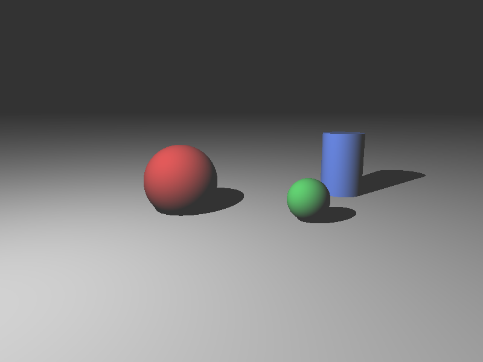

# miniRT — трассировщик лучей на Python + NumPy



---

## Описание

**miniRT** — учебный проект, вдохновлённый одноимённым заданием школы 42
(оригинал выполняется на C с библиотекой MiniLibX). Программа читает текстовое
описание сцены формата `.rt`, строит фотореалистичное изображение методом
обратной трассировки лучей и показывает его в окне. По запросу изображение
сохраняется в PNG.

Реализация — на **Python 3.11+** с использованием **NumPy** для векторной
математики и **pygame-ce** для окна.

**Метод:** из камеры через центр каждого пикселя экрана пускается луч; для
каждого луча находится ближайший объект на его пути; в точке попадания
вычисляется нормаль и цвет по освещению (фоновый свет + диффузное отражение
по закону Ламберта). Точки, от которых источник света заслонён другим
объектом, получают только фоновый свет — так получаются жёсткие тени.

**Возможности:**

- чтение и валидация файла `.rt` с точной диагностикой ошибок
  (строка, причина);
- камера с ортонормированным базисом и углом обзора;
- объекты: сфера, плоскость, конечный цилиндр с крышками — в любом
  количестве, пересекающиеся и вложенные;
- освещение: фоновый свет `A` и точечный источник `L`, диффузное
  отражение по закону Ламберта, жёсткие тени;
- сохранение результата в PNG, отображение в окне, завершение по `Esc`
  или по закрытию окна;
- покрытие логики модульными тестами, статическая типизация `mypy --strict`,
  линтер `ruff` без замечаний;
- рендер сцены `scenes/three.rt` в 800×600 укладывается в норматив 3 с
  (фактически ≈ 0,54 с на NumPy).

## Установка и запуск

### Требования

- Python 3.11 или новее;
- `pip` и `venv` (обычно идут в комплекте с Python);
- на Linux для окна `pygame-ce` могут понадобиться системные библиотеки
  SDL2 (`sudo apt install libsdl2-2.0-0`).

### Шаги установки

```bash
# 1. Клонировать репозиторий
git clone https://github.com/<ваш-логин>/minirt-python.git
cd minirt-python

# 2. Создать виртуальное окружение
python -m venv .venv

# 3. Активировать его
#   Windows (PowerShell):
.venv\Scripts\Activate.ps1
#   Windows (cmd):
.venv\Scripts\activate.bat
#   macOS / Linux:
source .venv/bin/activate

# 4. Обновить pip
python -m pip install --upgrade pip

# 5. Установить проект и зависимости для разработки
python -m pip install -e ".[dev]"

# 6. (опционально) Pillow — только для сохранения PNG через --out
python -m pip install pillow
```

> **Замечание про `pygame`.** В проекте используется пакет `pygame-ce`
> (community edition) — активно поддерживаемый форк с тем же API.
> Модуль по-прежнему импортируется как `import pygame`. Готовые wheels
> для новых версий Python доступны на PyPI.

### Запуск

```bash
python main.py scenes/three.rt
```

Если файл сцены не указан или указан неверно — печатается справка и
возвращается код 2. Если файла нет или формат неверный — сообщение
в stderr (начинается со слова Error) и код 1.

## Коды возврата

| Код | Когда возвращается |
|-----|---------------------|
| `0` | Успешное завершение (окно закрыто) |
| `1` | Ошибка ввода-вывода или ошибка формата сцены |
| `2` | Неверные аргументы командной строки |

## Параметры запуска

| Флаг | Назначение | По умолчанию |
|------|------------|--------------|
| `--width` | ширина изображения | 800 |
| `--height` | высота изображения | 600 |
| `--out` | сохранить результат в PNG | — |
| `--no-window` | не открывать окно | выкл. |

## Примеры

```bash
python main.py scenes/three.rt                               # эталонная сцена
python main.py scenes/three.rt --width 1280 --height 720     # другой размер
python main.py scenes/three.rt --out result.png              # сохранить PNG
python main.py scenes/cylinders.rt --no-window --out cyl.png # без окна
```

## Управление

| Действие | Результат |
|----------|-----------|
| `Esc` | Завершить работу программы |
| Закрытие окна (крестик) | Завершить работу программы |

## Формат сцены

Файл сцены — текстовый, с расширением `.rt`. Каждая непустая строка
описывает один элемент: идентификатор и поля через пробелы. Векторы и
цвета записываются тремя числами через запятую без пробелов.
Текст после `#` — комментарий.

Система координат: `x` — вправо, `y` — вверх, `z` — вглубь сцены;
единицы произвольные.

### Правила

- ровно один `A`, ровно одна `C`, хотя бы один `L`;
- яркость (`A`, `L`) — вещественное число `0..1`;
- цвет (`A`, `L`, `sp`, `pl`, `cy`) — три целых `0..255`;
- компоненты направления камеры — в `[-1, 1]`, вектор не нулевой
  (нормируется парсером);
- угол обзора — в градусах, `0 < fov < 180`;
- диаметр и высота цилиндра, диаметр сферы — строго положительны;
- нормаль плоскости — ненулевой вектор (нормируется парсером).

| Элемент | Поля | Ограничения |
|---------|------|-------------|
| `A` — фоновый свет | яркость, цвет | ровно один; яркость `0..1` |
| `C` — камера | позиция, направление, fov | ровно одна; направление `∈ [-1,1]`; `0 < fov < 180` |
| `L` — источник света | позиция, яркость, цвет | хотя бы один; яркость `0..1` |
| `sp` — сфера | центр, диаметр, цвет | диаметр `> 0` |
| `pl` — плоскость | точка, нормаль, цвет | нормаль ненулевая |
| `cy` — цилиндр | центр оси, ось, диаметр, высота, цвет | диаметр `> 0`, высота `> 0` |

Пример `scenes/three.rt`:

```text
# сцена: плоскость, две сферы, цилиндр
A 0.2 255,255,255
C 0,3,-10 0,-0.2,1 70
L -6,8,-4 0.8 255,255,255
pl 0,-1,0 0,1,0 200,200,200
sp -2.5,0.2,4 3 220,50,50
sp 2.5,-0.2,2.5 1.6 60,200,80
cy 5,0,7 0,1,0 2 4 70,110,230
```

### Ошибки формата

Парсер возбуждает `SceneFormatError` (наследник `RtError`) с указанием
номера строки. Например:

```text
строка 2: яркость фонового света должна быть в диапазоне 0..1, получено 1.5
строка 5: нормаль плоскости должен состоять из 3 чисел через запятую
строка 8: у элемента cy ожидается 5 полей
```

Отсутствие файла — стандартный `OSError`, парсер его не перехватывает.
Сообщение пользователю формирует `main.py` (печатает `Error: <причина>`
в `stderr`).

### Структура проекта

```text
minirt-python/
├── main.py              # точка входа: аргументы, коды возврата, тайминг
├── pyproject.toml       # настройки pytest, mypy, ruff, setuptools
├── README.md            # этот файл
├── .gitignore           # служебные файлы не попадают в git
├── minirt/              # пакет с логикой
│   ├── __init__.py
│   ├── errors.py        # RtError, SceneFormatError
│   ├── vec.py           # векторная математика на NumPy
│   ├── parser.py        # чтение и валидация .rt → Scene
│   ├── scene.py         # Ambient, Camera, Light, Scene, SceneObject
│   ├── shapes.py        # Sphere, Plane, Cylinder: пересечения, нормали
│   ├── camera.py        # базис камеры, лучи через пиксели массивами
│   ├── render.py        # ближайший объект, тени, Ламберт, uint8
│   └── window.py        # единственный модуль с pygame, Esc/закрытие
├── scenes/              # примеры сцен
│   ├── three.rt         # плоскость, две сферы, цилиндр
│   ├── cylinders.rt     # несколько цилиндров, крышки и бока
│   └── bad/             # сцены с ошибками формата
│       ├── no_ambient.rt
│       ├── bad_brightness.rt
│       ├── bad_color.rt
│       ├── bad_fov.rt
│       ├── bad_direction.rt
│       ├── bad_sphere.rt
│       ├── bad_cylinder.rt
│       └── bad_sp_fields.rt
├── tests/               # модульные тесты
│   ├── conftest.py      # общие фикстуры (SCENES, сцены)
│   ├── test_public.py   # публичные тесты стартового набора
│   ├── test_parser.py
│   ├── test_vec.py
│   ├── test_camera.py
│   ├── test_sphere.py
│   ├── test_plane.py
│   ├── test_cylinder.py
│   ├── test_lighting.py
│   └── test_image.py
└── docs/
    └── screenshot.png   # скриншот приложения
```

### Назначение модулей

| Модуль | Роль |
|--------|------|
| `main.py` | Разбор аргументов CLI, обработка `RtError`/`OSError`, коды возврата, тайминг, сохранение PNG, запуск окна |
| `minirt/errors.py` | Иерархия исключений: `RtError` (базовое), `SceneFormatError` (формат `.rt` с номером строки) |
| `minirt/vec.py` | Чистые функции над `np.ndarray`: `dot`, `cross`, `length`, `normalize`, `vec3` |
| `minirt/parser.py` | Чтение `.rt`, проверка полей/диапазонов, построение `Scene`. Единственное место, где открывается файл |
| `minirt/scene.py` | Модель данных: `Ambient`, `Camera`, `Light`, `Scene`, алиас `SceneObject` |
| `minirt/shapes.py` | Геометрия: `Sphere`, `Plane`, `Cylinder`, пересечение луча и нормали |
| `minirt/camera.py` | Базис `(forward, right, up)`, массив направлений первичных лучей `(H, W, 3)` |
| `minirt/render.py` | Векторная трассировка: ближайший объект, теневые лучи, Ламберт, сборка `(H, W, 3) uint8` |
| `minirt/window.py` | Единственный GUI-модуль: показ готового изображения, `Esc`, закрытие окна |

### Ключевая идея архитектуры

Логика (`parser`, `shapes`, `camera`, `render`) **не зависит** от
графической библиотеки. `pygame` импортируется только в
`minirt/window.py`. Это позволяет:

- тестировать логику без дисплея (все тесты, кроме `window.py`, идут
  без окна);
- заменять `pygame` на `tkinter`, `PyQt` и др. без правок в парсере,
  геометрии и рендере;
- использовать рендер в скриптах с флагом `--no-window`.

### Ключевая идея производительности

Первичные лучи обрабатываются **массивами** формы `(N, 3)`, цикл идёт
только по объектам сцены; внутри объекта пересечения считаются
векторно (NumPy). Это даёт ускорение в ~30 раз по сравнению с
попиксельным циклом на чистом Python (см. раздел «Производительность»).

---

## Тесты

### Команды

```bash
pytest -q
mypy --strict minirt main.py
ruff check . && ruff format --check .
```

Перед каждым pull request должны успешно выполняться все три команды.

### Что покрыто тестами

- **Парсер** (`tests/test_parser.py`):
  - разбор `scenes/three.rt`: все элементы, нормировка направления
    камеры, радиус = диаметр / 2, комментарии и пустые строки;
  - по одному тесту на каждую ошибку формата на сценах из
    `scenes/bad/` с проверкой текста сообщения и номера строки;
  - разбор значений через `@pytest.mark.parametrize` (границы диапазонов).

- **Векторная математика** (`tests/test_vec.py`):
  - `dot`, `cross`, `length`, `normalize` на известных значениях.

- **Камера** (`tests/test_camera.py`):
  - ортонормированность базиса (`f ⊥ r ⊥ u`, длины = 1);
  - центральный луч совпадает с направлением взгляда;
  - крайние лучи отклонены на ≈ `fov/2`;
  - взгляд вертикально вниз не даёт `NaN`.

- **Сфера** (`tests/test_sphere.py`):
  - луч мимо, снаружи (ближайший корень), изнутри (дальний корень),
    сфера позади камеры.

- **Плоскость** (`tests/test_plane.py`):
  - пересечение, плоскость позади, параллельный луч.

- **Цилиндр** (`tests/test_cylinder.py`):
  - попадание в бок, в нижнюю крышку, мимо выше крышки,
    луч параллельно оси; нормали бока и крышки.

- **Освещение** (`tests/test_lighting.py`):
  - градиент освещения на плоскости;
  - тень от сферы на плоскости (сравнение того же пикселя пола
    с тенью и без неё).

- **Изображение** (`tests/test_image.py`):
  - размер и тип `(H, W, 3) uint8`;
  - верхняя строка кадра соответствует фону от ambient
    (`ratio_A · 255`);
  - нижняя строка освещена (пол в кадре).

- **Публичные тесты** (`tests/test_public.py`):
  - имена модулей, сигнатуры и соглашения (базис камеры, выбор корня,
    нормали, формулы освещения).

Минимальный объём — 12 тестов сверх публичных соблюдён (фактически
около 40 с учётом параметризации по `scenes/bad/`).

### Покрытие

```bash
python -m pip install pytest-cov
pytest --cov=minirt --cov-report=term-missing
```

`minirt/window.py` покрыт не полностью — т.к. GUI тестами не
покрывается.

## Производительность

Замеры эталонных реализаций на сцене `scenes/three.rt`, AMD Ryzen 2.30 ГГц:

| Реализация | 800×600 |
|---|---|
| Чистый Python: цикл по пикселям, кортежи и `math` | ≈ 16 с (32 мкс на пиксель) |
| NumPy: все лучи массивами, цикл только по объектам | ≈ 0,54 с |
| `scenes/three.rt`  | ≈ 0.68 с |
| `scenes/cylinders.rt` (4 цилиндра) | ≈ 1.14 с |

Норматив — не более 3 с на `scenes/three.rt` в 800×600. Достигнуто
за счёт:

- массива направлений `(N, 3)` на все пиксели сразу;
- цикла только по объектам сцены (не по пикселям);
- векторных `np.where` вместо `if` на каждый луч;
- `sqrt(dot)` вместо `np.linalg.norm`;
- базис камеры вычисляется один раз на кадр.

Замер выполняется через `time.perf_counter()` вокруг `render()` и
печатается в `stderr`:

```text
render: 0.542 s (800x600)
```


## Лицензия

OPENSOURCE